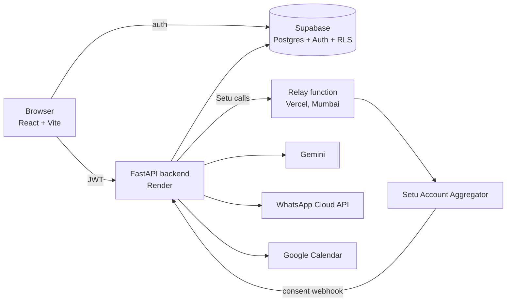

# Autopay Guard

[](https://github.com/nandyalanarendrar-spec/Auto_Pay_Reminder/actions/workflows/ci.yml)

**Never get surprised by an autopay again.** Autopay Guard finds the subscriptions and EMIs hiding in your bank
transactions, reminds you before they are charged, and warns you when a price goes up or a free trial quietly turns paid.

- **Live app:** https://auto-pay-reminder.vercel.app
- **API health:** https://auto-pay-reminder.onrender.com/health

> The bank connection runs against the **Setu Account Aggregator sandbox**: the consent and OTP flow is real, the
> accounts and transactions are Setu's test data. A built-in demo bank (six months of realistic transactions) shows
> the detection features without a bank. This is a portfolio project, not a production financial product.

<!-- Add 3-4 screenshots here: docs/screenshots/dashboard.png, spending.png, review.png, alerts.png -->

## Why it exists

Indian users lose money to payments they stopped noticing: a ₹1 trial that becomes ₹499 a month, a streaming plan
that quietly gets 30% dearer, an EMI that is due the day the balance is low. Account Aggregator data only gives plain
transactions, with no "this is a subscription" label, so the app **infers** recurring payments itself.

## Features

| Area | What it does |
|---|---|
| **Bank connection** | Link a bank through RBI's Account Aggregator framework (Setu sandbox): real consent, OTP, daily data pull, disconnect and revoke |
| **Detection** | Reads transactions and proposes subscriptions and EMIs: merchant grouping, amount tolerance, 7/30/365 day cycles, `n/m` instalment parsing, ₹1-trial-to-paid, price hikes. You confirm or ignore each suggestion |
| **Alerts** | Price-hike and trial-turned-paid alerts the moment they are detected, free-trial ending warnings, payment reminders at 7/3/1/0 days |
| **Spending dashboard** | Monthly totals, change versus last month, top merchants |
| **Savings simulator** | Tick subscriptions to cancel and see monthly and yearly savings (yearly and weekly plans normalised) |
| **Assistant** | Chat that answers from your real data (subscriptions, EMIs, spending), with cancellation steps for common Indian services; understands Telugu keywords |
| **Reminders & calendar** | Personal reminders (repeating, multi-time), calendar view, Google Calendar sync |
| **Channels** | In-app and browser notifications, WhatsApp (Meta Cloud API) to the user's own number |

## Architecture



**Data flow for a bank connection**

1. The user enters their mobile number; the backend creates a consent at Setu and returns the approval link.
2. The user approves with an OTP on Setu's page and returns to the app.
3. The backend (webhook, return visit, or the daily job) fetches the transactions into a single `transactions` table
   with a unique `(user_id, external_id)` so re-fetching never duplicates.
4. The detector writes suggestions to `detected_items`; the user confirms or ignores them in the Review screen.

**Worth knowing**

- Setu's login endpoint answers the backend host with an AWS load balancer `403`, while Indian addresses are accepted.
  Setu calls therefore go through a small **Vercel function pinned to Mumbai** (`api/setu-relay.js`): shared-key
  protected, allow-listed to Setu hosts, and optional (the backend calls Setu directly when no relay is configured).
- Row-level security is enabled on every public table. The browser only ever holds the public anon key.
- Alerts are deduplicated per item in `notification_logs`, so a price hike is announced once.

## Tech stack

| Layer | Technology |
|---|---|
| Frontend | React 18, Vite, Tailwind CSS, Recharts, lucide-react |
| Backend | Python 3.11, FastAPI, SQLAlchemy, Pydantic |
| Data | Supabase (Postgres, Auth, Row Level Security) |
| Integrations | Setu Account Aggregator, Google Gemini, Meta WhatsApp Cloud API, Google Calendar |
| Hosting | Vercel (frontend + relay), Render (backend), Supabase |
| Quality | pytest (unit and live-database tests), GitHub Actions CI |

## Project layout

```
app/                FastAPI application
  routes/           HTTP endpoints (bank, subscriptions, emis, analytics, chatbot, ...)
  services/         business logic (detection, Setu client, insights, notifications, ...)
  core/             settings and auth
src/                React application (components/, utils/, lib/)
api/                Vercel serverless function (Setu relay)
db/                 SQL schema, RLS policies and migrations for Supabase
docs/               extra documentation
scripts/            one-off helper scripts
tests/              pytest suite
```

## API overview

All routes live under `/api/v1` and require a Supabase JWT, except health, sign-up/login, the Google OAuth callback and
the Setu webhook.

| Prefix | Purpose |
|---|---|
| `/auth` | sign-up, login, phone completion |
| `/subscriptions`, `/emis` | CRUD, autopay toggle, mark paid, snooze |
| `/bank` | demo data, Setu connect/sync/disconnect, detected items, spending, alerts, webhook |
| `/analytics` | spend summary, what-if cancellation, budget status |
| `/chatbot` | assistant and cancellation guide |
| `/personal-reminders` | reminders with repeat and offsets |
| `/notifications`, `/whatsapp`, `/integrations` | alerts, WhatsApp, Google Calendar |

Interactive docs are served at `/docs` on the backend.

## Run it locally

Requirements: Python 3.11, Node 20, a Supabase project.

```bash
# 1. configuration
cp .env.example .env        # then fill in the values

# 2. database: run the SQL files in db/ in the Supabase SQL editor (start with supabase_schema.sql)

# 3. backend  (http://127.0.0.1:8000)
pip install -r requirements.txt
uvicorn backend.main:app --reload

# 4. frontend (http://127.0.0.1:3000)
npm install
npm run dev
```

Without Setu credentials the app still works: load the **demo bank** from the home screen to see detection, alerts and
the spending dashboard.

## Tests

```bash
pip install pytest
python -m pytest -m "not live_db"   # unit tests only, what CI runs
python -m pytest                    # everything, including tests that use a real Supabase project
```

Tests marked `live_db` sign up a throwaway user, exercise the real flows, and delete that user afterwards.

## Deployment

Vercel deploys the frontend and the relay on every push to `main`. Render hosts the API. Environment variables and the
relay setup are described in [docs/DEPLOYMENT.md](docs/DEPLOYMENT.md).

## Known limitations

- The Setu connection is sandbox only; going to production needs Setu production access and FIU onboarding.
- The sandbox returns random transactions without recurring patterns, so detection is demonstrated on the demo bank.
- Push notifications are dispatched in simulation mode; real FCM delivery arrives with the mobile app.
- The backend runs on a free tier and can take up to a minute to wake after inactivity.

## Roadmap

Android app (Capacitor) with native alarms and real push, mandate watchdog (alert on a first-time autopay debit),
cash-flow forecast with bounce-risk days, and a Telugu voice assistant.
